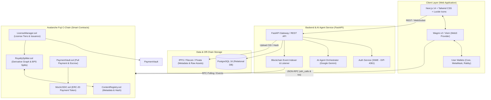
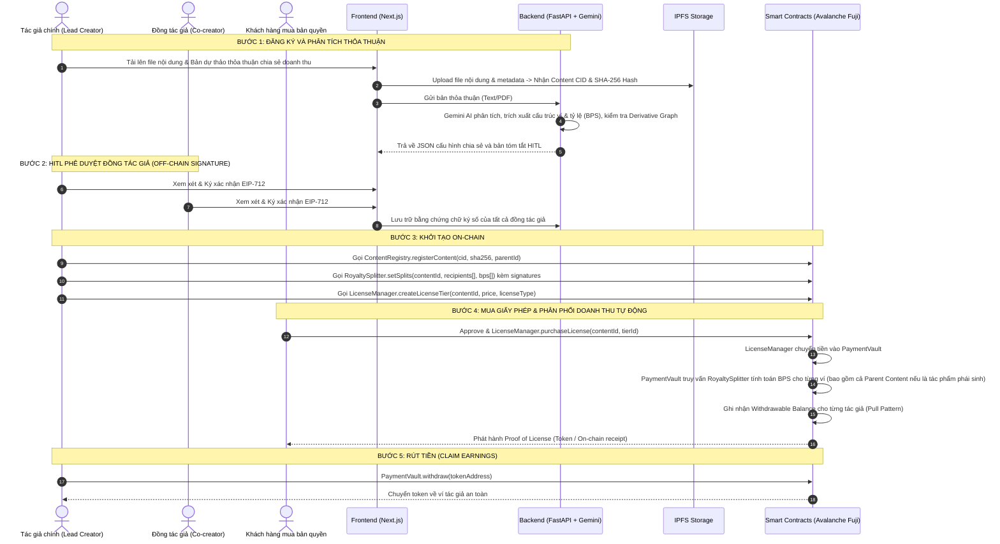
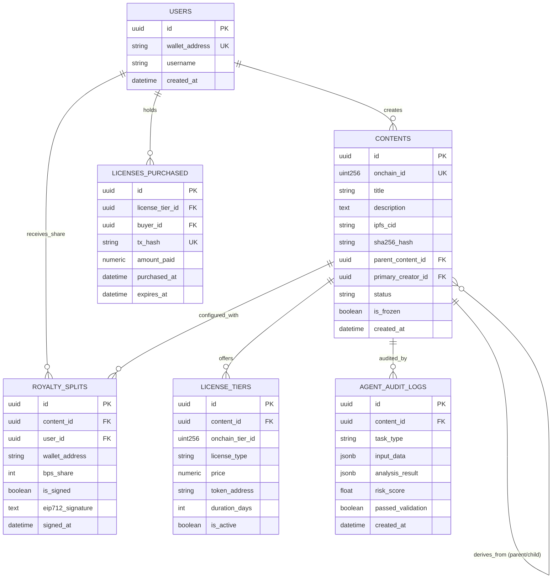
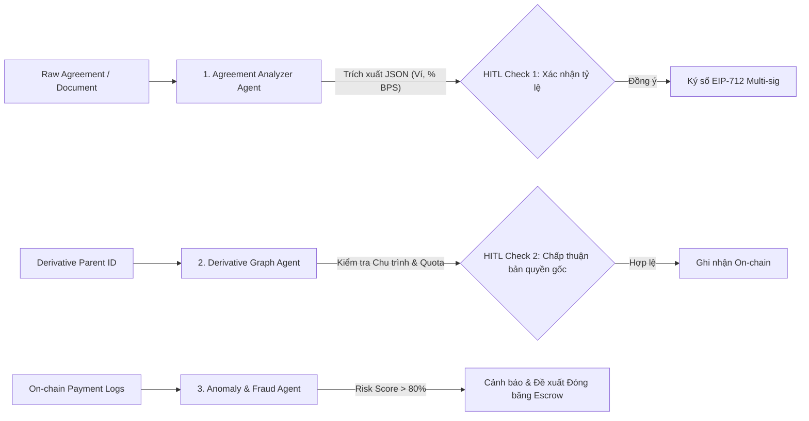
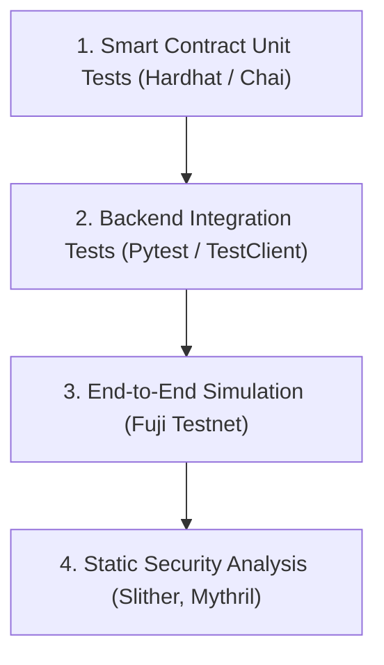

# TÀI LIỆU THIẾT KẾ HỆ THỐNG HOÀN CHỈNH (SYSTEM DESIGN SPECIFICATION)
## DỰ ÁN: ROYALTYFLOW - NỀN TẢNG PHÂN PHỐI DOANH THU BẢN QUYỀN SỐ
**Mã dự án:** `project_h15`  
**Phiên bản:** 1.0.0 (Production-Ready Spec)  
**Hệ sinh thái:** Avalanche Fuji (C-Chain), FastAPI (Python), Next.js 14, Google Gemini AI  
**Ngày cập nhật:** Tháng 11/2026  

---

## 1. TỔNG QUAN DỰ ÁN & BÀI TOÁN KINH DOANH

### 1.1. Bối cảnh & Vấn đề Cốt lõi (Pain Points)
Trong nền kinh tế sáng tạo số (Digital Creator Economy), việc sáng tạo nội dung (âm nhạc, hình ảnh, mã nguồn số, tài liệu học thuật, 3D asset) thường có sự tham gia của nhiều đồng tác giả (co-creators):
- **Phụ thuộc bên thứ ba & Thiếu minh bạch:** Doanh thu thường do một bên đại diện (hoặc nền tảng trung gian) thu hộ, sau đó đối soát và chia thủ công qua bảng tính. Quá trình này chậm trễ (từ vài tuần đến hàng quý), dễ xảy ra sai sót, thiếu minh bạch và rủi ro chiếm dụng vốn.
- **Tác phẩm phái sinh (Derivative Works) phức tạp:** Khi một sản phẩm số được phối lại (remix), biên dịch, cải biên hoặc tích hợp vào tác phẩm phái sinh, việc truy vết bản quyền gốc và phân phối ngược dòng (upstream royalties) gần như bất khả thi nếu không có hệ thống biểu đồ quyền tự động. Dẫn đến nguy cơ tranh chấp hoặc tính trùng/chi thừa bản quyền.
- **Rào cản pháp lý & kỹ thuật cho nhà sáng tạo:** Các thỏa thuận phân chia tỷ lệ thường được viết bằng ngôn ngữ pháp lý phức tạp, thiếu công cụ tự động hóa việc dịch các thỏa thuận này thành quy tắc thực thi bất biến (smart contract rules).

### 1.2. Mục tiêu & Giải pháp (RoyaltyFlow Solution)
**RoyaltyFlow** là nền tảng kết hợp giữa **Web3 Smart Contracts** và **Agentic AI** nhằm:
1. **Tự động hóa hoàn toàn việc phân phối doanh thu:** Khách hàng thanh toán phí giấy phép (bằng token USDC/AVAX), Smart Contract tự động tính toán và chia tiền ngay lập tức theo đúng tỷ lệ đã được cam kết.
2. **Derivative Royalty Graph (Sơ đồ Bản quyền Phái sinh):** Cấu trúc dữ liệu có hướng (DAG) cho phép liên kết tác phẩm phái sinh với tác phẩm gốc, tự động trích tỷ lệ % doanh thu cho tác phẩm cha trước khi chia cho các đồng tác giả tác phẩm con, đảm bảo không bao giờ chi vượt 100% (tránh double-counting).
3. **AI Co-pilot với Human-in-the-Loop (HITL):** LLM (Google Gemini) đóng vai trò phân tích văn bản thỏa thuận, phát hiện xung đột, kiểm tra đồ thị bản quyền và cảnh báo giao dịch bất thường. Các đồng tác giả phải ký xác thực mật mã (EIP-712 cryptographic signature) để kích hoạt on-chain, đảm bảo quyền kiểm soát tuyệt đối thuộc về con người.

---

## 2. KIẾN TRÚC TỔNG THỂ HỆ THỐNG (SYSTEM ARCHITECTURE)

### 2.1. Sơ đồ Kiến trúc Đa tầng (High-Level Architecture)



### 2.2. Luồng Dữ liệu Hoạt động Cốt lõi (Core Data Flow)



---

## 3. THIẾT KẾ SMART CONTRACTS & ON-CHAIN STATE

### 3.1. Nguyên lý Thiết kế On-Chain
1. **Kiến trúc Tách biệt Trách nhiệm (Separation of Concerns):** Mỗi contract chịu trách nhiệm độc lập: Đăng ký (`ContentRegistry`), Phân chia (`RoyaltySplitter`), Cấp phép (`LicenseManager`), Giữ và Rút tiền (`PaymentVault`).
2. **Mẫu Thanh toán Kéo (Pull-over-Push Pattern):** Không bao giờ tự động chuyển tiền trực tiếp trong vòng lặp (vòng for) cho nhiều ví nhằm tránh tấn công Từ chối dịch vụ (Denial of Service - DoS qua `revert`) và tiết kiệm gas. Doanh thu được ghi nhận vào `balances[recipient]`, các tác giả tự gọi hàm `withdraw()`.
3. **Độ chính xác Điểm cơ bản (Basis Points - BPS):** Sử dụng hệ số mẫu số $10,000$ ($10,000\text{ bps} = 100\%$, $100\text{ bps} = 1\%$, $1\text{ bps} = 0.01\%$). Mọi cấu hình phải đảm bảo $\sum \text{bps} = 10,000$.
4. **Chuẩn Mật mã Xác thực (EIP-712):** Mọi sự đồng thuận thay đổi tỷ lệ hoặc đăng ký ban đầu đều có thể xác thực chữ ký off-chain của các đồng tác giả trên chuỗi.
5. **Bảo mật:** Tích hợp OpenZeppelin `ReentrancyGuard`, `SafeERC20`, `OwnableUpgradeable`/`AccessControl`.

---

### 3.2. Chi tiết từng Smart Contract

#### A. `ContentRegistry.sol`
*Mục đích:* Quản lý danh tính số của tác phẩm, liên kết metadata IPFS, hash bảo toàn dữ liệu và thiết lập quan hệ phái sinh.

```solidity
struct ContentItem {
    uint256 contentId;
    address primaryCreator;
    string ipfsCid;            // IPFS CID chứa nội dung hoặc metadata
    bytes32 contentSha256;      // SHA-256 hash của raw file off-chain
    uint256 parentContentId;    // 0 nếu là tác phẩm gốc (Root), > 0 nếu là phái sinh
    uint256 registrationTime;
    bool isRegistered;
    bool isFrozen;              // Đóng băng trong trường hợp có tranh chấp (Dispute)
}
```
*Các hàm cốt lõi:*
- `registerContent(string memory ipfsCid, bytes32 contentSha256, uint256 parentContentId) returns (uint256)`: Đăng ký tác phẩm mới.
- `freezeContent(uint256 contentId)`: Quản trị viên/Tòa trọng tài đóng băng giao dịch khi có tranh chấp bản quyền.
- `unfreezeContent(uint256 contentId)`: Mở khóa khi tranh chấp được giải quyết.

#### B. `RoyaltySplitter.sol`
*Mục đích:* Quản lý tỷ lệ chia sẻ doanh thu cho từng tác phẩm, bao gồm thuật toán đệ quy/lan truyền theo đồ thị phái sinh (Derivative Royalty Graph).

```solidity
struct SplitRule {
    address[] recipients;
    uint256[] bpsShares;       // Tổng = 10,000 bps
    uint256 upstreamBps;       // Tỷ lệ trích trả về tác phẩm gốc (nếu là phái sinh)
    bool isLocked;             // Khóa sau khi tất cả đồng tác giả đã ký
}
```
*Logic Derivative Royalty Graph:*
- Giả sử Tác phẩm Con $B$ phái sinh từ Tác phẩm Gốc $A$.
- Khi đăng ký $B$, hệ thống quy định $B$ phải trích $15\%$ ($1,500\text{ bps}$) doanh thu chuyển về cho Tác phẩm $A$.
- Doanh thu còn lại ($85\%$ hay $8,500\text{ bps}$) được chia theo thỏa thuận nội bộ giữa các đồng tác giả của $B$ (tổng trọng số quy đổi về $100\%$ của phần còn lại).
- Thuật toán chống lặp (Cycle Detection): Khi thiết lập quan hệ phái sinh, hợp đồng kiểm tra không tồn tại chu trình (A -> B -> C -> A) và giới hạn độ sâu phái sinh tối đa (ví dụ: Max Depth = 5 tầng) để tránh cạn kiệt Gas (Out-of-Gas).

#### C. `LicenseManager.sol`
*Mục đích:* Định nghĩa các gói giấy phép sử dụng thương mại, định giá theo token và xử lý giao dịch mua.

```solidity
enum LicenseType { PERSONAL, COMMERCIAL, DERIVATIVE_ALLOW, EXCLUSIVE }

struct LicenseTier {
    uint256 tierId;
    uint256 contentId;
    LicenseType licenseType;
    address paymentToken;      // Địa chỉ ERC-20 (mock USDC) hoặc address(0) cho AVAX
    uint256 price;             // Giá cấp phép
    uint256 durationInDays;    // 0 = Vĩnh viễn (Perpetual)
    bool isActive;
}

struct LicenseRecord {
    uint256 licenseId;
    uint256 tierId;
    uint256 contentId;
    address licensee;          // Người mua
    uint256 purchaseTime;
    uint256 expiresAt;
}
```
*Các hàm cốt lõi:*
- `createTier(...)`: Tác giả tạo gói cấp phép.
- `purchaseLicense(uint256 tierId)`: Người mua chuyển token -> LicenseManager phân bổ trực tiếp sang `PaymentVault`.

#### D. `PaymentVault.sol`
*Mục đích:* Két thanh toán an toàn, ghi nhận số dư khả dụng và cho phép người thụ hưởng rút tiền.

```solidity
// Mapping: tokenAddress => (userAddress => balance)
mapping(address => mapping(address => uint256)) public pendingBalances;

// Mapping: contentId => tổng doanh thu lịch sử đã tạo ra
mapping(uint256 => mapping(address => uint256)) public totalContentRevenue;
```
*Các hàm cốt lõi:*
- `creditRevenue(uint256 contentId, address token, uint256 amount)`: Được gọi bởi `LicenseManager`. Sử dụng thông tin từ `RoyaltySplitter` để tăng `pendingBalances[token][recipient]`.
- `withdraw(address token)`: Tác giả rút toàn bộ số dư khả dụng của token tương ứng về ví của mình (`nonReentrant`).
- `withdrawBatch(address[] calldata tokens)`: Rút tiền hàng loạt nhiều token trong một giao dịch.

---

## 4. THIẾT KẾ BACKEND & CƠ SỞ DỮ LIỆU (FASTAPI + POSTGRESQL)

### 4.1. Cấu trúc Mô-đun Backend (`api/app`)
```text
api/app/
├── core/
│   ├── config.py           # Quản lý biến môi trường (Pydantic Settings)
│   ├── security.py         # SIWE (EIP-4361) & JWT Token verification
│   └── database.py         # SQLAlchemy Async Engine & Session Manager
├── models/
│   ├── base.py             # Declarative Base & Audit Mixins
│   ├── user.py             # Model User & Wallet
│   ├── content.py          # Model Content, Derivative Graph Nodes & Edges
│   ├── royalty.py          # Model Royalty Split & Signatures
│   ├── license.py          # Model License Tiers & Purchases
│   └── agent_log.py        # Model AI Agent audit logs & dispute reports
├── schemas/
│   ├── content.py          # Pydantic schemas cho đăng ký tác phẩm
│   ├── royalty.py          # Pydantic schemas cho tỷ lệ phân chia & EIP-712
│   ├── license.py          # Pydantic schemas cho giao dịch mua bán
│   └── ai_agent.py         # Request/Response schemas cho LLM processing
├── services/
│   ├── ipfs_service.py     # Tải lên IPFS & tính toán mã băm SHA-256
│   ├── web3_service.py     # RPC client tương tác với Avalanche Fuji Contracts
│   ├── agent_service.py    # Google Gemini Orchestrator (Agreement, Graph, Fraud)
│   └── indexer_service.py  # Blockchain event listener & DB synchronizer
└── routers/
    ├── health.py           # Health checks
    ├── auth.py             # EIP-4361 Web3 Login (Nonce & Verify Signature)
    ├── contents.py         # Quản lý tác phẩm & tải lên metadata
    ├── royalties.py        # Quản lý cấu hình chia & HITL signatures
    ├── licenses.py         # Marketplace API
    └── ai_copilot.py       # API phân tích thỏa thuận & kiểm tra biểu đồ quyền
```

### 4.2. Sơ đồ Quan hệ Thực thể Cơ sở Dữ liệu (Database ERD)



### 4.3. Đặc tả RESTful API Endpoints Chủ chốt

| Phương thức | Endpoint | Mô tả | Yêu cầu xác thực |
| :--- | :--- | :--- | :--- |
| `POST` | `/api/v1/auth/nonce` | Lấy nonce ngẫu nhiên để chuẩn bị ký SIWE | Public |
| `POST` | `/api/v1/auth/verify` | Xác thực chữ ký EIP-4361, cấp JWT token | Public |
| `POST` | `/api/v1/contents/upload` | Upload file lên IPFS, sinh SHA-256 hash và trả về CID | JWT (Creator) |
| `POST` | `/api/v1/ai/analyze-agreement` | LLM đọc văn bản hợp đồng, trích xuất co-creators & % chia | JWT (Creator) |
| `POST` | `/api/v1/ai/validate-graph` | Kiểm tra xung đột & vòng lặp trong cây phái sinh | JWT (Creator) |
| `POST` | `/api/v1/royalties/sign` | Đồng tác giả gửi chữ ký EIP-712 xác nhận tỷ lệ | JWT (Co-creator) |
| `GET` | `/api/v1/contents/{id}/tree` | Lấy toàn bộ cây tác phẩm phái sinh để hiển thị đồ thị | Public |
| `GET` | `/api/v1/licenses/marketplace` | Danh sách các giấy phép đang chào bán | Public |
| `GET` | `/api/v1/analytics/anomalies` | Danh sách cảnh báo giao dịch bất thường do AI phát hiện | JWT (Admin) |

---

## 5. HỆ THỐNG AI AGENT & QUY TRÌNH HUMAN-IN-THE-LOOP (HITL)

### 5.1. Vai trò của AI Agent
Hệ thống AI đóng vai trò là một **Intelligent Co-Pilot & Security Guard**, không có quyền tự ý chuyển tiền hay ký giao dịch on-chain thay cho con người. Cụ thể:



1. **Agreement Analyzer Agent (Phân tích Thỏa thuận):**
   - Đọc hợp đồng dạng văn bản hoặc tóm tắt từ nhà sáng tạo.
   - Nhận diện danh sách đồng tác giả, địa chỉ ví, tỷ lệ đóng góp.
   - Chuẩn hóa tỷ lệ sang đơn vị BPS (tổng chính xác 10,000 bps). Đưa ra đề xuất loại giấy phép phù hợp (Personal, Commercial, Derivative-allowed).
2. **Derivative Graph Validator Agent (Kiểm tra Phái sinh):**
   - Truy vấn lịch sử giấy phép của tác phẩm gốc (Parent Content): Tác phẩm gốc có cho phép phái sinh (Derivative) không? Có điều khoản giới hạn độc quyền không?
   - Tính toán tỷ lệ cascade: Đảm bảo phần trích nộp cho tác phẩm gốc và các tác phẩm phân nhánh không vượt quá $100\%$ doanh thu ròng.
3. **Payment Anomaly Detector (Phát hiện Bất thường):**
   - Quét các sự kiện mua bản quyền từ `LicenseManager`.
   - Nhận diện các hành vi như: Wash trading (tự mua giấy phép của chính mình để đẩy khối lượng ảo), thanh toán dồn dập trong thời gian ngắn từ cùng một nguồn IP/ví, hoặc chênh lệch giá bất thường so với mức giá niêm yết trung bình.

### 5.2. Cơ chế Bắt buộc Human-In-The-Loop (HITL)
- **Ký đồng thuận 100% (Consensus Multi-signing):** Trước khi gọi `RoyaltySplitter.setSplits`, tất cả địa chỉ ví có tên trong danh sách thụ hưởng phải đăng nhập vào hệ thống và ký xác thực cấu trúc dữ liệu theo chuẩn EIP-712:
  ```json
  {
    "types": {
      "RoyaltyAgreement": [
        {"name": "contentId", "type": "uint256"},
        {"name": "recipients", "type": "address[]"},
        {"name": "bpsShares", "type": "uint256[]"},
        {"name": "nonce", "type": "uint256"}
      ]
    }
  }
  ```
- **Xử lý tranh chấp (Dispute Resolution):** Nếu có khiếu nại về việc hash nội dung bị đánh cắp hoặc đạo nhái, hệ thống kích hoạt cơ chế `freezeContent()`. Doanh thu phát sinh trong giai đoạn này được giữ nguyên trong `PaymentVault` (dưới dạng Escrow) cho đến khi có phán quyết trọng tài xác nhận ví thụ hưởng chính chủ.

---

## 6. THIẾT KẾ FRONTEND & GIAO DIỆN NGƯỜI DÙNG (UI/UX)

### 6.1. Kiến trúc Giao diện (Next.js 14 App Router)
- **Công nghệ cốt lõi:** Next.js 14 (React 18), Tailwind CSS, Shadcn UI / Radix Primitives, Lucide React icons.
- **Tương tác Web3:** Wagmi v2 Hooks (`useAccount`, `useReadContract`, `useWriteContract`, `useWaitForTransactionReceipt`), Viem v2 utilities (`formatUnits`, `parseUnits`).
- **Quản lý State:** TanStack React Query v5 để cache dữ liệu API và on-chain event index.

### 6.2. Các Phân hệ Màn hình Chính
1. **Creator Studio (`/studio/register`):**
   - Khu vực kéo thả tải lên file sản phẩm số -> tự động tính mã băm SHA-256 trên trình duyệt (Web Crypto API) và upload IPFS.
   - Khung nhập văn bản thỏa thuận kèm nút "Phân tích bằng AI": Trợ lý AI hiển thị bản xem trước biểu đồ phân chia tỷ lệ phần trăm trực quan.
   - Lựa chọn tác phẩm cha nếu đây là sản phẩm phái sinh (Derivative Work).
2. **Trung tâm Ký kết Thỏa thuận (`/agreements/sign`):**
   - Danh sách các thỏa thuận đang chờ người dùng ký xác nhận.
   - Xem chi tiết bảng phân bổ tỷ lệ và chữ ký của các đồng tác giả khác.
   - Nút "Ký chấp thuận (EIP-712)" tích hợp trực tiếp với ví Web3.
3. **Derivative Graph Visualizer (`/explore/graph/{contentId}`):**
   - Hiển thị trực quan cây phái sinh (Interactive Node-Link Diagram).
   - Thể hiện rõ ràng dòng chảy phần trăm doanh thu hồi quy ngược về tác phẩm gốc.
4. **License Marketplace (`/marketplace`):**
   - Hiển thị danh sách tác phẩm được chào bán bản quyền thương mại.
   - Bộ lọc theo thể loại, giá tiền và loại giấy phép.
   - Modal mua 1-click: Hỗ trợ Approve token + Mua license trong luồng giao diện mượt mà.
5. **Dashboard Doanh thu & Rút tiền (`/dashboard/revenue`):**
   - Thống kê tổng doanh thu đã tích lũy, số dư khả dụng có thể rút (Real-time Withdrawable Balance).
   - Nút `Claim All Earnings` gọi hàm `PaymentVault.withdraw()` chuyển tiền thẳng về ví cá nhân.
   - Bảng lịch sử phân phối và minh chứng giao dịch on-chain (liên kết Snowtrace Avalanche Fuji).

---

## 7. QUY TRÌNH KIỂM THỬ & CHỈ SỐ ĐÁNH GIÁ (TESTING & KPIS)

### 7.1. Kế hoạch Kiểm thử Toàn diện



1. **Smart Contract Unit Tests:**
   - Kiểm tra tính toán phân chia: Tổng BPS phải luôn bằng 10,000; số lẻ đơn vị (rounding error) được xử lý an toàn (tối đa sai số 1 wei).
   - Kiểm tra bảo mật: Ngăn chặn Reentrancy trong hàm `withdraw()`.
   - Kiểm tra phân phối phái sinh: Thử nghiệm phân phối 3 cấp (Grandparent -> Parent -> Child), đảm bảo không tính trùng và tiền chuyển về đúng từng ví.
2. **Backend & AI Integration Tests:**
   - Mock test phản hồi của Google Gemini API với nhiều mẫu hợp đồng phức tạp (tiếng Anh và tiếng Việt).
   - Kiểm thử phát hiện chu trình đồ thị phái sinh (Cycle Graph Detection tests).
   - Kiểm thử xác thực chữ ký EIP-712 off-chain & on-chain.

### 7.2. Bộ Chỉ số KPI Kỹ thuật
- **Độ chính xác phân bổ:** $100.00\%$ doanh thu được phân bổ chính xác theo thỏa thuận trong mọi ca thử nghiệm.
- **Zero Double-counting:** $0\%$ trường hợp chi vượt hoặc chi trùng trên cây phái sinh.
- **Tốc độ phản hồi AI:** Thời gian phân tích thỏa thuận và trả kết quả cấu hình $< 3.5\text{ giây}$.
- **Hiệu quả Gas (Gas Optimization):** Chi phí gas cho giao dịch `purchaseLicense` và phân bổ dưới $150,000\text{ gas}$ trên Avalanche Fuji.

---

## 8. MÔI TRƯỜNG & HƯỚNG DẪN TRIỂN KHAI (DEPLOYMENT CONFIGURATION)

### 8.1. Cấu hình Mạng Avalanche Fuji Testnet
- **Network Name:** Avalanche Fuji C-Chain
- **Chain ID:** `43113`
- **RPC URL:** `https://api.avax-test.network/ext/bc/C/rpc`
- **Block Explorer:** `https://testnet.snowtrace.io`
- **Native Currency:** `AVAX`

### 8.2. Thứ tự Triển khai Smart Contracts (Deployment Sequence)
1. Triển khai `MockUSDC.sol` (dùng để test thanh toán bằng Stablecoin trên Fuji).
2. Triển khai `ContentRegistry.sol`.
3. Triển khai `RoyaltySplitter.sol` (kết nối với `ContentRegistry`).
4. Triển khai `PaymentVault.sol` (kết nối với `RoyaltySplitter`).
5. Triển khai `LicenseManager.sol` (kết nối với `ContentRegistry`, `RoyaltySplitter`, `PaymentVault`).
6. Cấp quyền `OPERATOR_ROLE` / `PAYMENT_CALLER` từ `PaymentVault` cho `LicenseManager`.
7. Cập nhật địa chỉ hợp đồng vào file cấu hình `.env` của Backend và Frontend.
